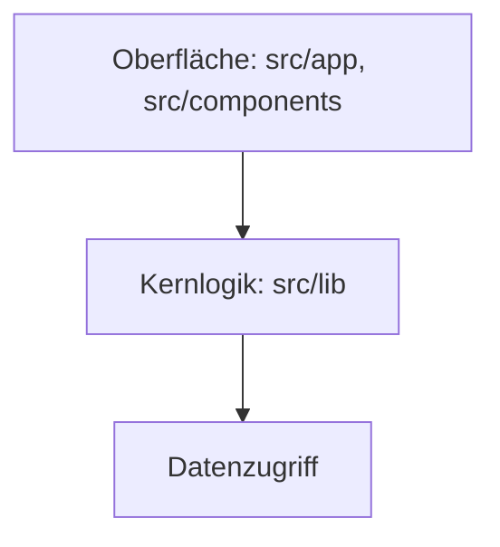
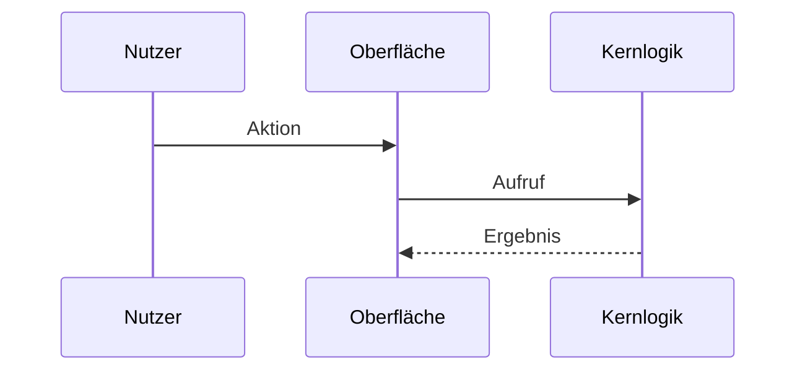
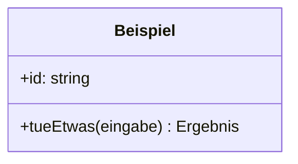
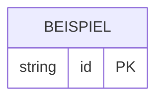

# Architektur

Wird vom architect erstellt und bei jedem Epic geprüft. Vom Menschen freigegeben.
Status: Vorlage | freigegeben am <Datum> von <Name>

## Änderungen
| Datum | Epic | Was hat sich geändert |
| --- | --- | --- |

## Notation
Welche Sicht mit welcher Diagrammart beschrieben wird und warum. Alle Diagramme in Mermaid,
damit sie im Repo versioniert und im Pull Request geprüft werden.

| Sicht | Diagrammart | Warum diese |
| --- | --- | --- |
| Bausteine und Abhängigkeiten | Komponentendiagramm (Flowchart) | |
| Abläufe zwischen Bausteinen | Sequenzdiagramm | |
| Abläufe mit Verzweigungen, Zustände | Aktivitäts- oder Zustandsdiagramm | |
| Struktur der Kernlogik | Klassendiagramm | |
| Daten | ER-Diagramm | |

## Architekturtreiber
Die Qualitätsziele aus `docs/vision.md` und was sie für den Aufbau bedeuten.

| Qualitätsmerkmal | Konkrete Anforderung | Folge für die Architektur |
| --- | --- | --- |

## Stil
Gewählter Architekturstil, Begründung, verworfene Alternative, Quelle. Verweis auf die Entscheidungsnotiz.

## Bausteine

| Baustein | Aufgabe | Darf abhängen von | Verbirgt (Information Hiding) |
| --- | --- | --- | --- |

## Schnittstellen
Was ein Baustein anderen anbietet. Alles andere ist intern.

| Baustein | Funktion (Signatur) | Zweck | Fehlerfälle |
| --- | --- | --- | --- |

## Verhalten
Je Kernablauf ein Sequenzdiagramm. Abläufe mit Verzweigungen zusätzlich als Aktivitäts- oder Zustandsdiagramm.

## Detailentwurf
Typen und Dienste der Kernlogik.

## Datenmodell

| Entität | Feld | Typ | Regel |
| --- | --- | --- | --- |

## Entwurfsprinzipien
Wie Modularisierung, Information Hiding, lose Kopplung und hohe Kohäsion hier umgesetzt sind,
und wo bewusst davon abgewichen wird (mit Verweis auf die Entscheidungsnotiz).

## Anforderung → Realisierung
| Story | Bausteine | Schnittstellen | Daten |
| --- | --- | --- | --- |

## Betrieb
Wo läuft die Anwendung (Adresse der gehosteten Version), wo liegen die Daten, wie wird ausgeliefert.

## Risiken und offene Punkte
-
