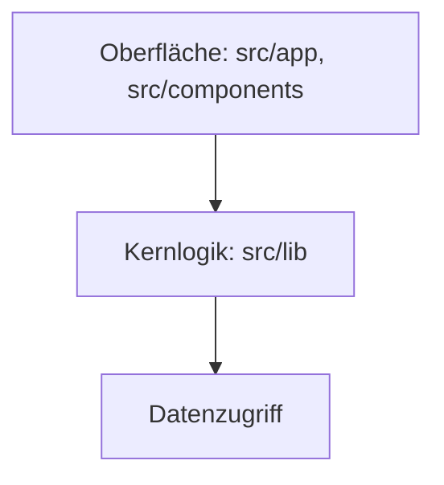
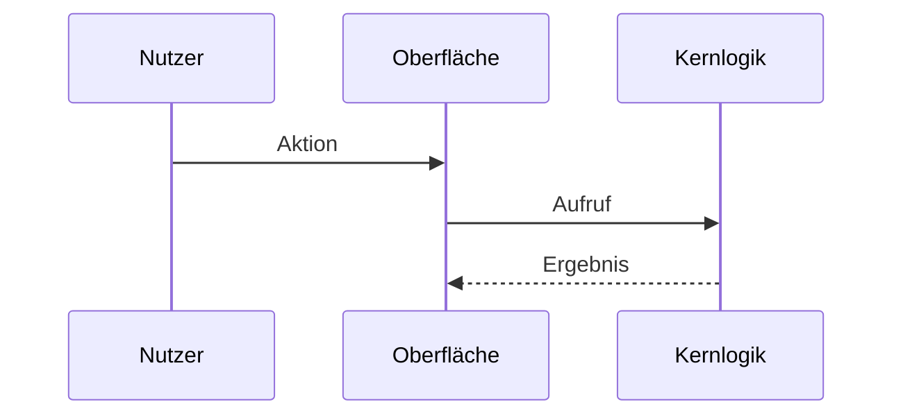

# Architektur

Wird vom architect erstellt und bei jedem Epic geprüft. Vom Menschen freigegeben.
Status: Vorlage | freigegeben am <Datum> von <Name>

## Änderungen
| Datum | Epic | Was hat sich geändert |
| --- | --- | --- |

## Architekturtreiber
Die Qualitätsziele aus `docs/vision.md` und was sie für den Aufbau bedeuten.

| Qualitätsmerkmal | Konkrete Anforderung | Folge für die Architektur |
| --- | --- | --- |

## Stil
Gewählter Architekturstil, Begründung, verworfene Alternative.

## Bausteine

| Baustein | Aufgabe | Darf abhängen von |
| --- | --- | --- |

## Wichtigster Ablauf

## Datenmodell
Die wichtigsten Entitäten und ihre Beziehungen.

## Betrieb
Wo läuft die Anwendung, wo liegen die Daten.

## Risiken und offene Punkte
-
