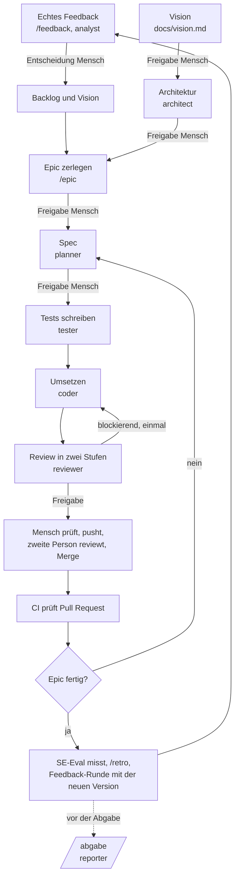

# Prozess

Wie in diesem Projekt entwickelt wird, wer was tut und wo der Mensch entscheidet.

## Ablauf

## Rollen

| Rolle | Aufgabe | Schreibt nur in | Modell |
| --- | --- | --- | --- |
| Orchestrator (Hauptsitzung) | steuert Reihenfolge, prüft Ergebnisse, hält an Freigabepunkten | `docs/backlog.md`, `docs/learnings.md`, `docs/tech-debt.md`, `docs/management/` | Standard der Sitzung |
| analyst | echtes Feedback auswerten, Konsequenzen vorschlagen | `docs/feedback.md`, `docs/feedback/` | stark |
| architect | Architekturtreiber, Stil, Bausteine, Detailentwurf, Datenmodell | `docs/architecture.md`, `docs/decisions/` | stark |
| planner | Story in prüfbare Spec übersetzen | `specs/` | stark |
| tester | fehlschlagende Tests aus der Spec | Testdateien, `specs/` | mittel |
| coder | Tests grün machen | alles außer Testdateien, Spec und Review | mittel |
| reviewer | gegen Spec, Architektur und Regeln prüfen | `specs/F-XX/review.md`, `log.md` | stark |
| reporter | Abgabedokumente zusammenstellen | `abgabe/` | mittel |

Die Spalte "Schreibt nur in" wird vom Schutz-Hook `.claude/hooks/guard.mjs` durchgesetzt.
Er lehnt außerdem für alle ab: `git push`, `git pull`, `git merge`, Commits auf `main`, `--no-verify`, `.env`-Dateien.
Grenze: Der Hook prüft die Werkzeuge zum Schreiben von Dateien und git-Befehle. Er ersetzt nicht das Lesen des Diffs durch den Menschen.

## Befehle

| Befehl | Wann | Ergebnis |
| --- | --- | --- |
| `/start` | einmal pro Projekt | Vision und Architektur |
| `/feedback <Rohmaterial>` | nach jedem Gespräch, Nutzertest, jeder Umfrage | Einträge im Feedback-Register, entschiedene Konsequenzen |
| `/epic <Beschreibung>` | pro Epic | Stories im Backlog mit Quelle, Architektur geprüft |
| `/feature F-XX` | pro Story | Spec, Tests, Code, Review auf einem Branch |
| `/status` | jederzeit | Stand von Backlog, Branch, laufender Story, Feedback |
| `/retro <Sprint>` | je Sprint | Retrospektive mit Fakten aus dem Repo und Antworten des Teams |
| `/abgabe [Bereich]` | vor Präsentationen und vor der Abgabe | Entwürfe der Abgabedokumente mit Liste der Lücken |

## Freigabepunkte des Menschen

1. Vision
2. Konsequenz aus jedem Feedback
3. Architektur (beim Start und wenn ein Epic sie ändert)
4. Liste der Stories eines Epics
5. Spec jeder Story
6. Push und Merge jeder Story, nach eigenem Ausprobieren der App und Review durch eine zweite Person

## Automatische Prüfungen

| Prüfung | Wann | Wirkung |
| --- | --- | --- |
| Schutz-Hook | vor jedem Schreiben und jedem Shell-Befehl eines Agenten | Aktion wird abgelehnt |
| `make check` | vor jedem Commit, durch Agenten | Agent darf nicht weiter |
| `make trace` | je Story und in der CI | zeigt Lücken zwischen Feedback, Story, Kriterium und Test |
| CI | bei jedem Pull Request | blockiert den Merge |
| SE-Eval | pro Epic | Bericht zum Vergleich über die Zeit |

## Bezug zu den Software-Engineering-Aktivitäten

| Aktivität | Umsetzung hier |
| --- | --- |
| Anforderungen: Ziele, Kontext, Hypothesen | `docs/vision.md` |
| Anforderungen: Erhebung mit echten Personen | `/feedback`, `docs/feedback.md`, `docs/feedback/roh/` |
| Anforderungen: funktional, Qualität, Randbedingungen, Szenarien | Spec je Story (Story, Szenario, Gegeben-Wenn-Dann, messbare Qualität) |
| Anforderungen: Priorisierung und Verhandlung | Backlog-Reihenfolge, Freigabe der Story-Liste |
| Anforderungen: Validierung | Regeln des planner gegen Mehrdeutigkeit, Freigabe der Spec, Feedback-Runde je Epic |
| Anforderungen: Traceability und Versionierung | Quelle je Story, Feature-ID in Spec, Branch, Commit, Test; `docs/traceability.md`; Git |
| Architektur: Treiber, Stil, Sichten, Entscheidungen | `docs/architecture.md`, `docs/decisions/` mit Quellen |
| Architektur: Bewertung | Prüfung durch architect bei jedem Epic, Freigabe durch den Menschen |
| Entwurf: Prinzipien | `docs/coding-standards.md`, Prüfpunkte E1 bis E7 im Review |
| Entwurf: Dokumentation | Abschnitt "Entwurf" in der Spec, Klassen- und ER-Diagramm in der Architektur |
| Implementierung: Kommentare, Konventionen | `docs/coding-standards.md`, Lint, Schutz-Hook |
| Implementierung: Code Smells, technische Schulden | reviewer, SE-Eval, `docs/tech-debt.md` |
| Test: Unit, Integration, System, Abnahme, Nutzertest | `docs/teststrategie.md` |
| Test: Reviews und Inspektionen | `docs/review-leitfaden.md`, `specs/F-XX/review.md`, Review im Pull Request |
| Test: Fehlerverfolgung | Tickets mit Vorlage "Fehler" im Projekt-Board |
| Konfigurationsmanagement | Branch je Story, Pull Request, geschützter `main` |
| Management: Praktiken, Reflexion, Probleme | `docs/management/praktiken.md`, `retros/`, `probleme.md` |
| Management: Aufwand und Statistik | `docs/management/zeiterfassung.csv`, `make stats` |
| Messung | SE-Eval, siehe `docs/se-eval.md` |
| Abgabe | `docs/abgabe.md`, `/abgabe` |
