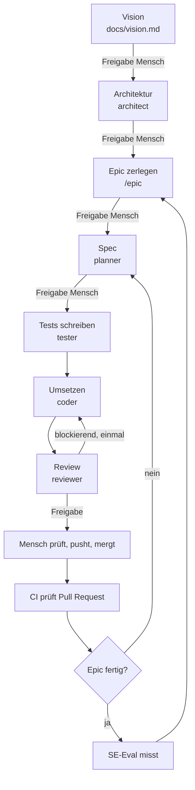

# Prozess

Wie in diesem Projekt entwickelt wird, wer was tut und wo der Mensch entscheidet.

## Ablauf

## Rollen

| Rolle | Aufgabe | Schreibt in | Modell |
| --- | --- | --- | --- |
| Orchestrator (Hauptsitzung) | steuert Reihenfolge, prüft Ergebnisse, hält an Freigabepunkten | `docs/backlog.md`, `docs/learnings.md`, `docs/tech-debt.md` | Standard der Sitzung |
| architect | Architekturtreiber, Stil, Bausteine | `docs/architecture.md`, `docs/decisions/` | stark |
| planner | Story in prüfbare Spec übersetzen | `specs/` | stark |
| tester | fehlschlagende Tests aus der Spec | Testdateien | mittel |
| coder | Tests grün machen | Anwendungscode | mittel |
| reviewer | gegen Spec, Architektur und Regeln prüfen | nichts | stark |

## Befehle

| Befehl | Wann | Ergebnis |
| --- | --- | --- |
| `/start` | einmal pro Projekt | Vision und Architektur |
| `/epic <Beschreibung>` | pro Epic | Stories im Backlog, Architektur geprüft |
| `/feature F-XX` | pro Story | Spec, Tests, Code, Review auf einem Branch |
| `/status` | jederzeit | Stand von Backlog, Branch und laufender Story |

## Freigabepunkte des Menschen

1. Vision
2. Architektur (beim Start und wenn ein Epic sie ändert)
3. Liste der Stories eines Epics
4. Spec jeder Story
5. Push und Merge jeder Story, nach eigenem Ausprobieren der App

## Automatische Prüfungen

| Prüfung | Wann | Wirkung |
| --- | --- | --- |
| `make check` | vor jedem Commit, durch Agenten | Agent darf nicht weiter |
| CI | bei jedem Pull Request | blockiert den Merge |
| SE-Eval | pro Epic | Bericht zum Vergleich über die Zeit |

## Bezug zu den Software-Engineering-Aktivitäten

| Aktivität | Umsetzung hier |
| --- | --- |
| Anforderungen: Ziele, Kontext, Erhebung | `docs/vision.md` |
| Anforderungen: funktional, Qualität, Randbedingungen, Szenarien | Spec je Story |
| Anforderungen: Priorisierung und Verhandlung | Backlog-Reihenfolge, Freigabe der Story-Liste |
| Anforderungen: Validierung | Regeln des planner gegen Mehrdeutigkeit, Freigabe der Spec |
| Anforderungen: Traceability und Versionierung | Feature-ID in Spec, Branch, Commit, Test; Zuordnungstabelle; Git |
| Architektur: Treiber, Stil, Sichten, Entscheidungen | `docs/architecture.md`, `docs/decisions/` |
| Architektur: Bewertung | Prüfung durch architect bei jedem Epic, Freigabe durch den Menschen |
| Entwurf: Prinzipien | Entwurfsregeln in `CLAUDE.md`, Prüfpunkte des reviewer |
| Entwurf: Dokumentation | Abschnitt "Entwurf" in der Spec, Diagramme in der Architektur |
| Implementierung: Kommentare, Konventionen | Regeln in `CLAUDE.md`, Lint |
| Implementierung: Code Smells, technische Schulden | reviewer, SE-Eval, `docs/tech-debt.md` |
| Test: Unit, Integration, System, Abnahme | Vitest, E2E, Akzeptanzkriterien, Ausprobieren durch den Menschen |
| Konfigurationsmanagement | Branch je Story, Pull Request, geschützter `main` |
| Messung | SE-Eval, siehe `docs/se-eval.md` |
